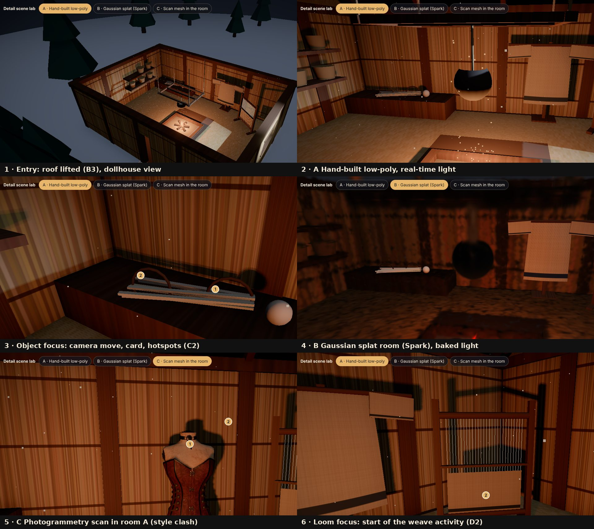

# Detail scene: findings and recommendation

Date: 2026-11-25. Scope: the interior "detail scene" for the lake house
story. Island world and 3D objects are explored in other threads.

Single full-size shots are in the project files folder `detail-scene/`. Run the lab with `npm run dev` (see README).

## Recommendation for Thursday

1. **Build the room as hand-made low-poly (variant A).** It matches the
   island style, it is fully under our control (no invented cultural detail
   from a scan or a generator), and it costs almost nothing to load.
2. **Use the high 3/4 "dollhouse" camera as the room's home view.** The
   most charming frame in all tests is the entry shot with the roof lifted
   (comparison #1). Eye-level views inside a 7 × 5 m room feel cramped and
   need tight camera limits. Recommended flow: owl lands → roof lifts →
   camera settles at the dollhouse view → click an object → camera moves in
   (C2) → card + hotspots → `Esc` back to the dollhouse view.
3. **Bake the light, keep one live light.** Real-time point-light shadows
   render the scene 6 extra times (cube shadow map). For the app: bake AO and
   the hearth light into a lightmap (Blender → GLB) or accept no shadows plus
   `ContactShadows`; keep only a flickering hearth light and emissive embers
   live. Merge static meshes (`MergeStatic`): 572 → 396 draw calls here.
4. **Keep the interaction code from this lab** (see README): `CameraControls`
   + an async `Director`, emissive hover glow, one projected DOM overlay for
   labels and hotspots, keyboard `1–3` / `Esc`.
5. **Show scanned objects in the focus view, not loose in the room.** A real
   scan looks great alone but clashes with the low-poly room (#5). Put the
   scan in the "picked up" card viewport (C2) on a neutral backdrop.
6. **Gaussian splats are the "after Thursday" path** for real captured
   places (see below). Spark is ready; the content and the rights are not.

## Variant results

| | A · Low-poly | B · Splat (Spark 2.4) | C · Scan mesh |
| --- | --- | --- | --- |
| Look | Cosy, consistent with island; needs art direction for contrast | Soft, painterly, light is baked in; blurry up close | Photo-real object; clashes with stylised room |
| Download | ~0 KB (procedural) / a baked GLB would be ~0.3–1 MB | Real captures: typically 5–30 MB `.spz` for a room | 394 KB after gltf-transform (13.5 MB raw) |
| GPU memory | small | 16 B per splat: 150k = 2.4 MB, 400k = 6.4 MB | textures ≤1024² WebP |
| Draw calls* | 396 (fx on, merged), 572 unmerged, ~250 roof-open | 28 | 331 |
| Relight / season / time of day | yes | no, light is baked in the capture | yes |
| Interactive objects | yes | yes: mesh objects inside the splat sort correctly | yes |
| Authoring cost | hours (code or Blender) | needs a capture session + permission + cleanup (SuperSplat) | needs a scan + rights |
| Cultural risk | low (we decide every detail; labelled illustrative) | depends on the place captured and consent | depends on the object and licence |

\* Headless Chromium with SwiftShader (CPU). FPS from this machine is
meaningless (1–6 fps); calls, triangles and sizes are real. **Not yet
measured on a real GPU or phone.** That is the first check to do.

## Gaussian splats in more detail

- **Spark** (`@sparkjsdev/spark`, MIT, World Labs) works with three 0.180 and
  R3F: create a `SparkRenderer`, add `SplatMesh` objects. It sorts splats
  against normal meshes, so the three interactive objects can stay meshes
  with hover and click. It loads `.spz`, `.ply`, `.splat`, `.ksplat`, `.sog`.
- Our test splat is **synthetic**: room A sampled into 150k–400k flat splats
  with simple light baked into the colour (build time 250–590 ms in the
  browser). It proves the pipeline, not the look of a real capture.
- Ways to get real splats: phone capture (Scaniverse exports `.spz`/`.ply`),
  desktop training (Jawset Postshot), editing (PlayCanvas SuperSplat), or
  generation (World Labs Marble exports splats and documents Spark).
  Generated interiors of an Ainu house would invent cultural detail, so we
  should not use generation for cultural places.
- Limits: light is baked (no season or night change unless captured twice),
  blurry at close range, larger downloads, colliders and click targets must
  be added by hand, and capturing a real place needs permission from the
  place and the community.
- Fit with the vision: splats are the natural format for "places captured by
  cultural workers" on the contributor side. Good pitch for the roadmap; not
  needed for Thursday.

## Scans in more detail

- `gltf-transform optimize --compress meshopt --texture-compress webp
  --texture-size 1024` took the Khronos Corset scan from 13.5 MB to 394 KB.
  drei `useGLTF` decodes meshopt without setup.
- The National Ainu Museum publishes 3D object models (catalogue at
  nam-vm.jp, and a Sketchfab account "nam-3d-vr-model"). Licence and reuse
  terms are **not verified**; the 3D objects thread should check before use.

## Known issues in this lab

- Room A colour is too uniform (brown on brown). The window light hardly
  reads. Needs one art pass: darker corners, cooler window pool, warmer hearth.
- The hanging pot blocks the eye-level home view.
- Two `drei <Html>` roots mounting in the same render dropped one label.
  The lab now uses one projected DOM overlay instead.
- The splat variant has no roof-lift entry (the roof would need its own
  splat object).
